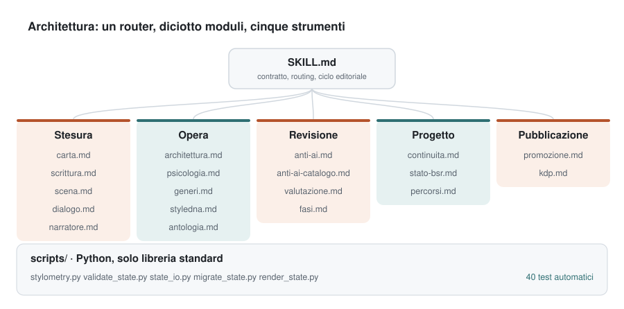
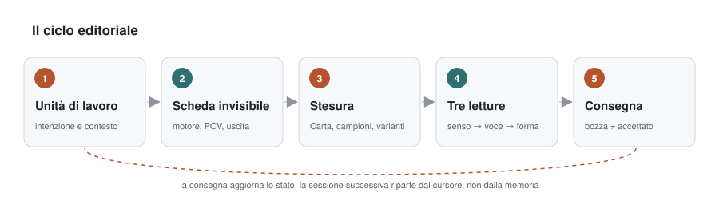
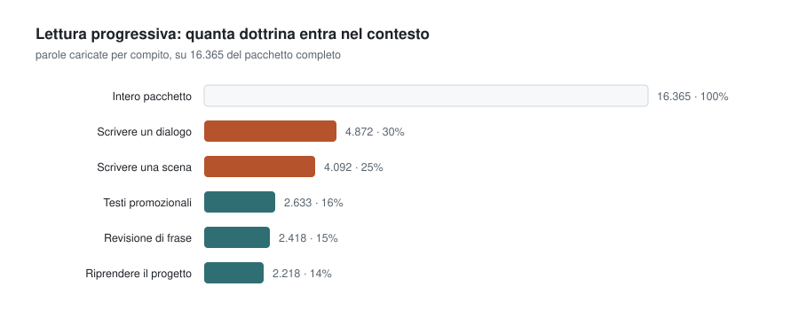
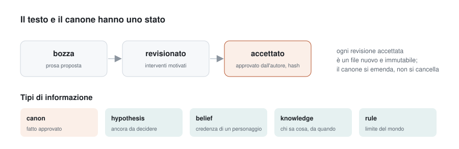

<p align="center"></p>

<h1 align="center">BookForge</h1>

<p align="center"><strong>Un sistema editoriale per scrivere romanzi con un modello linguistico<br>senza perdere la voce dell'autore né il filo della storia.</strong></p>

<p align="center">


</p>

---

BookForge è una *skill* per assistenti basati su modelli linguistici: un insieme di istruzioni, moduli di riferimento e strumenti Python che trasformano un assistente generico in un collaboratore editoriale per opere lunghe. Segue un libro dall'idea alla stesura, dalla revisione alla continuità fra capitoli e volumi, fino ai testi per la pubblicazione.

È progettato, scritto e validato da Simone Macelloni, autore di narrativa e giornalista, come strumento per il proprio lavoro di scrittura e come progetto di AI engineering.

## Il problema

Un modello linguistico scrive bene una pagina. Un romanzo è un'altra cosa: centinaia di pagine scritte in decine di sessioni, ognuna delle quali parte senza memoria della precedente. Lì emergono tre difetti strutturali.

| Difetto | Come si manifesta | Risposta di BookForge |
|---|---|---|
| **Deriva della voce** | Dopo qualche capitolo la prosa scivola verso lo stile medio del modello | Campioni di voce approvati, profilo StyleDNA a 12 assi, baseline stilometrica ancorata a un corpus |
| **Perdita di continuità** | Fatti contraddetti, personaggi che sanno cose che non dovrebbero sapere, promesse dimenticate | Stato di progetto in JSON validato, canone distinto da ipotesi e credenze, conoscenze attribuite a ogni personaggio |
| **Prosa generica** | Immagini di repertorio, spiegazioni superflue, dialoghi che passano informazioni, finali con la morale | Una dottrina di mestiere ricavata da manuali di scrittura e dalla ricerca sulla narrativa generata, applicata in stesura e in revisione |

## In numeri

| Parametro | Valore |
|---|---|
| Moduli di riferimento | 19, caricati solo quando servono |
| Strumenti Python | 5, senza dipendenze esterne |
| Test automatici | 40, tutti superati |
| Schema dello stato | 2.0, con validazione eseguibile e salvataggio atomico |
| Assi di stile (StyleDNA) | 12, con 18 preset di partenza per genere |
| Casi di valutazione | 4 prompt in italiano, eseguiti sulla versione nuova e sulla precedente |
| Fonti analizzate per la 7.8 | 8 manuali di scrittura, 5 articoli di ricerca |
| Contesto per scrivere una scena | circa il 25% della dottrina completa |

## Architettura

<p align="center"></p>

`SKILL.md` è il punto d'ingresso: stabilisce il contratto con l'autore, deduce dal compito quale percorso seguire e indica quali moduli leggere. I moduli sono raggruppati per funzione. Quelli di stesura dicono *come* costruire una scena; quelli di revisione dicono *che cosa cercare* in un testo già scritto; quelli di progetto gestiscono canone e stato.

Gli script fanno ciò che un modello non deve improvvisare: validare lo stato, salvarlo senza perdere dati, migrarlo fra versioni, misurare indicatori linguistici dell'italiano.

## Il ciclo editoriale

<p align="center"></p>

Ogni unità di lavoro, che sia un capitolo, una scena o un singolo movimento drammatico, attraversa lo stesso ciclo. La *scheda invisibile* è il passaggio che fa più differenza: prima di scrivere il modello fissa per sé che cosa sa già il lettore, che cosa è in moto sotto la superficie, che cosa il punto di vista fraintende e dove arriva la scena. Poi scrive solo la superficie, e la funzione della scena non compare mai nella prosa.

## Punti di forza

### 1. Lettura progressiva

<p align="center"></p>

Il pacchetto completo non entra mai nel contesto. Ogni compito carica solo i moduli che gli servono, e il resto resta fuori. Il beneficio è doppio: costa meno, e soprattutto il modello non mescola le istruzioni di revisione con quelle di stesura. Un elenco di difetti letto mentre si scrive produce una prosa difensiva.

### 2. Generare prima, correggere dopo

La dottrina separa due momenti. In stesura il modello riceve solo indicazioni positive: scegli il concreto, dai un limite allo sguardo, chiudi sull'azione. Gli indizi di genericità e manierismo entrano soltanto in revisione, e anche lì sono domande con le loro eccezioni, non divieti. È una scelta nata dall'esperienza delle versioni precedenti: quando i divieti erano presenti durante la stesura, il testo diventava timido e omologato.

### 3. Uno stato verificabile, non una memoria presunta

<p align="center"></p>

Un assistente non ricorda nulla fra una sessione e l'altra. BookForge non finge il contrario: la continuità passa per file che si possono verificare.

- Ogni revisione accettata è un file nuovo, con hash SHA-256.
- Il salvataggio controlla la revisione attesa, usa un lock, conserva un backup e sostituisce il JSON in modo atomico.
- Il canone non si cancella: un fatto si emenda con un nuovo record che sostituisce il precedente, e la storia resta leggibile.
- Ciò che un personaggio *crede* è distinto da ciò che è *vero* e da ciò che il *lettore sa*. È la distinzione che permette di scrivere un noir senza rivelazioni anticipate.

### 4. Il mestiere tradotto in istruzioni

La versione 7.8 nasce da un'analisi sistematica di otto manuali di scrittura (Franzoso, Carver, Gotham Writers' Workshop, Cotroneo, Loi, Novak, più due testi di copywriting e scrittura per l'audio). Ogni manuale è stato letto per intero e distillato in schede. Nella skill è entrato solo ciò che diventa una scelta concreta in stesura, una domanda in revisione o una procedura ripetibile.

Alcuni esempi di ciò che ne è uscito:

- **Tempi verbali come distanza.** Il passato remoto scolpisce, l'imperfetto ricorda, il presente rivive. È la risorsa più specifica dell'italiano, e i modelli tendono a ignorarla.
- **Coscienza fallibile.** Il punto di vista non capisce tutto e giudica dal proprio interesse. Corregge il narratore lucido e onnisciente che i modelli producono spontaneamente.
- **Regola della fonte.** Ogni stato d'animo di un altro personaggio deve avere una fonte, oppure diventare comportamento osservabile.
- **Dialogo come relazione.** Ogni battuta riprende la precedente e la sposta di lato; i personaggi non si raccontano ciò che sanno già.

Altrettanto importante è ciò che è stato scartato: i divieti assoluti, i verbi alternativi a «disse», i cataloghi del linguaggio del corpo e le tattiche manipolative del copywriting. Il registro completo delle scelte è in [docs/MODIFICHE_7.8.md](docs/MODIFICHE_7.8.md).

### 5. Contro l'omologazione

I modelli tendono alla risposta più tipica, e la ricerca lo documenta: stesure indipendenti della stessa premessa convergono sulle stesse trame e sulle stesse immagini. BookForge interviene in due modi.

- Nei punti decisivi (l'attacco, la svolta, il dettaglio rivelatore, la chiusura) il modello genera prima alcune alternative e scarta le più prevedibili. Poi sceglie la più vera, non la più strana.
- Per i dettagli di contorno cerca prima nel mondo dell'autore: canone, schede dei personaggi, la *tavolozza* di oggetti, gergo e abitudini che appartengono solo a quel libro.

I test hanno mostrato che la prima tecnica cambia le scelte strutturali ma non la grana delle immagini. La seconda funziona, a patto che la tavolozza esista. È un limite dichiarato, non nascosto.

### 6. Valutazione onesta

Ogni versione viene confrontata con la precedente su prompt reali, in contesti separati. L'autore giudica le uscite alla cieca, senza sapere quale versione le ha prodotte. Le metriche automatiche servono a individuare problemi, non a decretare la qualità: in una versione precedente lo script stilometrico aveva valutato peggio proprio la prosa migliore.

## Valutazione della versione corrente

| Verifica | Esito |
|---|---|
| Test automatici su stato, stilometria e migrazione | 40 su 40 |
| Compatibilità con gli stati di progetto esistenti | Piena: schema e script invariati dalla 7.7 |
| Vincoli rispettati nei 4 casi di prova (lunghezza, punto di vista, segreti non rivelati, fatti conservati) | 16 su 16, per la 7.7 come per la 7.8 |
| Costo di una stesura rispetto alla 7.7 | Circa +15% di token |
| Omologazione delle immagini fra stesure indipendenti | Ridotta solo quando il progetto fornisce una tavolozza del mondo |

Che cosa non è ancora dimostrato: che la 7.8 scriva *meglio* della 7.7 su una scena isolata (nei test la differenza è piccola, e buona parte del merito è del modello) e che il sistema regga voce e continuità su un romanzo intero. Sono i due prossimi passi della [roadmap](#roadmap).

## Ricerca di riferimento

- Chakrabarty et al., *Can AI writing be salvaged?* (CHI 2025): una tassonomia in sette categorie delle correzioni che scrittori professionisti applicano alla narrativa generata. È diventata la griglia della revisione. [arXiv:2409.14509](https://arxiv.org/abs/2409.14509)
- Chakrabarty et al., *Art or Artifice?* (CHI 2024): i 14 test TTCW sulla scrittura creativa; i modelli restano più indietro su originalità della forma e sottotesto. [arXiv:2309.14556](https://arxiv.org/abs/2309.14556)
- Zhang et al., *Verbalized Sampling* (2025): la convergenza dei modelli sulla risposta tipica, e come chiedere più candidati la riduca. [arXiv:2510.01171](https://arxiv.org/abs/2510.01171)
- Xu et al., *Echoes in AI* (2025): le trame generate si ripetono molto più di quelle umane. [arXiv:2501.00273](https://arxiv.org/abs/2501.00273)
- Huot et al., *Agents' Room* (ICLR 2025): separare pianificazione e stesura migliora i racconti. [arXiv:2410.02603](https://arxiv.org/abs/2410.02603)

## Struttura del repository

| Percorso | Contenuto |
|---|---|
| `SKILL.md` | Punto d'ingresso: contratto, lettura progressiva, ciclo editoriale |
| `references/` | 19 moduli: stesura, opera, revisione, progetto, pubblicazione |
| `scripts/` | Stilometria, validazione, salvataggio, migrazione, vista Markdown dello stato |
| `schemas/`, `examples/` | Schema JSON dello stato e progetto minimo vuoto |
| `tests/` | Suite di regressione (`unittest`) |
| `evals/` | Casi di valutazione: prompt, criteri, file di input |
| `docs/` | Installazione, istruzioni per GPT, registro delle modifiche, verifiche |
| `assets/` | Diagrammi di questo README |
| `archive/` | Documenti delle versioni precedenti, solo consultazione storica |

## Uso

BookForge richiede un assistente compatibile con le skill: non include un modello, una memoria permanente o un servizio di pubblicazione. Si lavora in linguaggio naturale. Scorciatoie come `/scrivi`, `/revisione`, `/lettore`, `/salva` e `/tavolozza` sono convenzioni del dialogo, non comandi dell'applicazione.

> Ho una bozza di romanzo noir. Aiutami a capire se la struttura funziona, conservando la voce asciutta del primo capitolo. Parti da una diagnosi breve e proponi la prossima unità di lavoro.

Gli strumenti richiedono Python 3.10 o successivo e la sola libreria standard:

```bash
python -m unittest discover -s tests -v
python scripts/validate_state.py examples/minimal/bookforge_state.json --root examples/minimal
```

L'uso è riservato al titolare: vedi [Licenza](#licenza-e-copyright).

## Roadmap

1. **Prova su un romanzo reale.** Più capitoli consecutivi con stato, campioni di voce e tavolozza; nessuna perdita di prosa o decisioni fra le sessioni.
2. **Giudizio alla cieca dell'autore** sui confronti 7.7/7.8, già preparati.
3. **Curva di tensione per capitolo** nello stato, recuperata da una linea di sviluppo precedente.
4. **Pilota con altri autori**, con misura del costo per capitolo accettato.

## Versioni

| Versione | Contributo principale |
|---|---|
| 7.8.2 | Tavolozza del mondo contro l'omologazione delle immagini |
| 7.8.1 | Audit: tolte le soglie numeriche, revisione divisa in nucleo e catalogo esteso |
| 7.8.0 | Strato di mestiere generativo: scena, dialogo, narratore, architettura, promozione |
| 7.7.0 | Stato a schema 2.0, salvataggio atomico, 40 test, stilometria corretta |
| 7.6 | Dottrina positiva in stesura, divieti confinati alla revisione |

## Licenza e copyright

Copyright © 2025–2026 Simone Macelloni. **Tutti i diritti riservati.**

BookForge **non è software libero né open source**. Il codice è pubblicato soltanto per la consultazione come portfolio. Copiarlo, usarlo, modificarlo, ridistribuirlo o usarlo per addestrare modelli richiede un'autorizzazione scritta. Il testo completo è nel file [LICENSE](LICENSE).
